<h1 align="center">Hey, I'm Aaryan!</h1>

  

<h2 align="center">My Contributions</h2>

  <picture>
    <source media="(prefers-color-scheme: dark)"
      srcset="https://raw.githubusercontent.com/AaryanMin0701/AaryanMin0701/output/pacman-contribution-graph-dark.svg">
    <source media="(prefers-color-scheme: light)"
      srcset="https://raw.githubusercontent.com/AaryanMin0701/AaryanMin0701/output/pacman-contribution-graph.svg">
    
  </picture>

